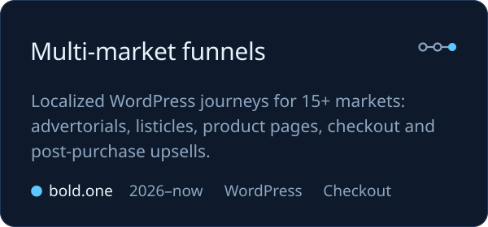
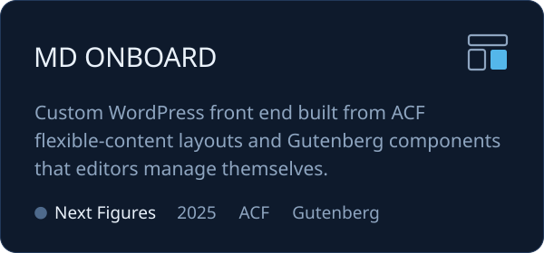
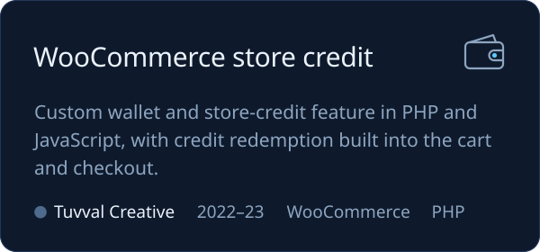
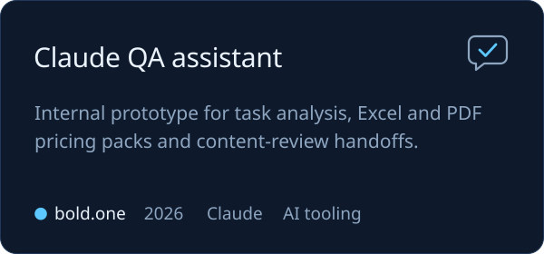

Senior front-end developer with 7 years in web development. I build React and TypeScript interfaces, WordPress and WooCommerce platforms, and interactive 3D product experiences. Right now I'm at bold.one, building localized WordPress e-commerce funnels for 15+ markets and the AI-assisted tooling around them.

I like owning a feature from requirements through implementation, testing and handover, in remote teams. Open to B2B cooperation in Poland and remote contracts across Europe.

### What I work on

<table>
  <tr>
    <td width="50%" valign="top">
      <b>E-commerce funnels</b> 
      Localized WordPress and WooCommerce journeys: advertorials, product pages, checkout and post-purchase upsells, with per-market routing and currency display.
    </td>
    <td width="50%" valign="top">
      <b>Editor-friendly WordPress</b> 
      Custom themes and plugins, ACF flexible-content layouts and Gutenberg components, so editors control structured pages without code changes.
    </td>
  </tr>
  <tr>
    <td width="50%" valign="top">
      <b>React, TypeScript and 3D</b> 
      React and TypeScript interfaces where WordPress pages need more interaction, and React Three Fiber product configurators.
    </td>
    <td width="50%" valign="top">
      <b>Performance and release quality</b> 
      Core Web Vitals and PageSpeed fixes, Safari and iOS cross-browser QA, Jest tests and GitHub Actions deployment checks.
    </td>
  </tr>
</table>

### Experience

M.A. in Language, Mind and Technology from Adam Mickiewicz University, Poznań. Web development tutor at Yazilim Kids Akademi from 2023 to 2026. I speak Turkish (native), English (C1) and Polish (A2).

### Stack

 

Also WooCommerce, ACF, Gutenberg, Elementor, WP-CLI, REST APIs, Mailgun and AI-assisted workflows with Claude.

### Selected work

More live work: the [Next Figures](https://nextfigures.com/) agency site and the [ITouch Systems](https://itouch.com.tr/) corporate site.

### Open source

- [WordPress Custom Endpoint Plugin](https://github.com/batuhanyigitt/WordPress-Custom-Endpoint-Plugin) pulls external API data into a custom WordPress endpoint and loads user details over AJAX.
- [WordPress Marquee Text Plugin](https://github.com/batuhanyigitt/WordPress_Marquee_Text_Plugin) adds a dismissible, animated announcement bar with no dependencies.
- [GraphQL Blog](https://github.com/batuhanyigitt/GraphQL-Blog-Project) is a Next.js blog on Hygraph with incremental static regeneration.
- [Angular Well-Being Tracker](https://github.com/batuhanyigitt/Angular_Well_Being_Tracker) logs mood and energy and charts the last two weeks.
- [React TypeScript Shopping Cart](https://github.com/batuhanyigitt/React-TypeScript-Shopping-Cart) is a cart built with React, TypeScript and Vite.

### Activity

<picture>
  <source media="(prefers-color-scheme: dark)" srcset="https://raw.githubusercontent.com/batuhanyigitt/batuhanyigitt/output/snake-dark.svg" />
  <source media="(prefers-color-scheme: light)" srcset="https://raw.githubusercontent.com/batuhanyigitt/batuhanyigitt/output/snake-light.svg" />
  
</picture>

