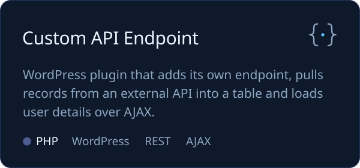
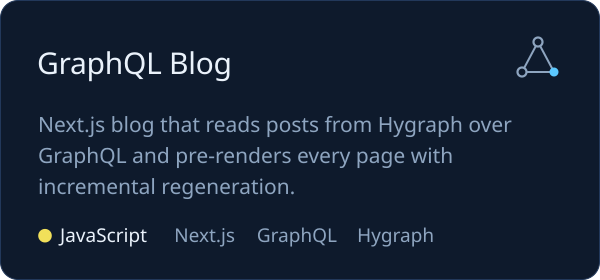
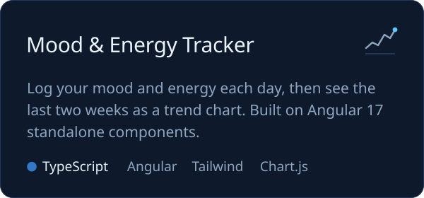
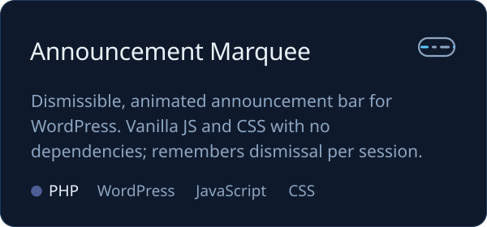

I build websites where WordPress meets modern JavaScript, and I've been doing it remotely for teams since 2019. Lately I'm spending more of my time in Three.js and WebGL, turning product pages into things you can spin, recolour and buy.

### What I work on

<table>
  <tr>
    <td width="33%" valign="top">
      <b>Headless WordPress</b> 
      WordPress as a content API behind React and Next.js front ends, served over REST or GraphQL.
    </td>
    <td width="33%" valign="top">
      <b>Fast storefronts</b> 
      WooCommerce and Shopify builds tuned for Core Web Vitals, SEO and accessibility.
    </td>
    <td width="33%" valign="top">
      <b>Interactive 3D</b> 
      Three.js and React Three Fiber scenes for product configurators and storytelling.
    </td>
  </tr>
</table>

Happy to talk about headless CMS setups, WordPress theme and plugin architecture, or making a slow site fast.

### Stack

 
 

Also WooCommerce, Shopify, REST APIs and CI/CD pipelines.

### Selected work

More in my [repositories](https://github.com/batuhanyigitt?tab=repositories).

### Activity

<picture>
  <source media="(prefers-color-scheme: dark)" srcset="https://raw.githubusercontent.com/batuhanyigitt/batuhanyigitt/output/snake-dark.svg" />
  <source media="(prefers-color-scheme: light)" srcset="https://raw.githubusercontent.com/batuhanyigitt/batuhanyigitt/output/snake-light.svg" />
  
</picture>

